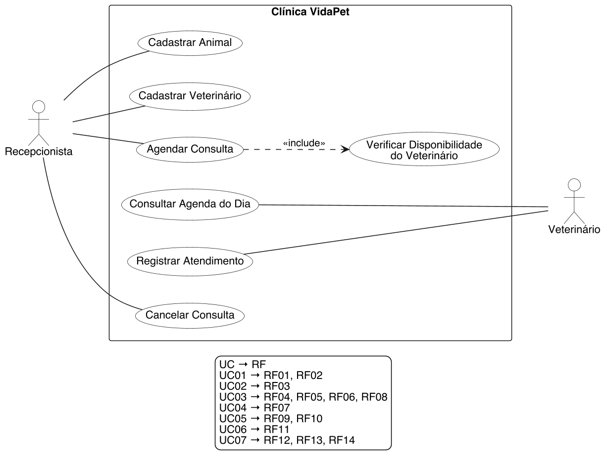

# Casos de Uso - Sistema de Agendamento VidaPet

Paulo Queiroz - Projeto de Bloco: Desenvolvimento Back End (PB) - TP1

## Atores

**Recepcionista:** Pessoa que atende na recepção da clínica. Cadastra animais e veterinários, agenda e cancela consultas.

**Veterinário:** Profissional que atende os animais. Consulta sua agenda do dia e registra a consulta como realizada, com as observações do atendimento.

## Casos de Uso

### UC01 - Cadastrar Animal

**Ator Principal:** Recepcionista\
**Descrição:** Registra um animal com nome, espécie (cão ou gato), idade, nome do tutor e telefone do tutor.

### UC02 - Cadastrar Veterinário

**Ator Principal:** Recepcionista\
**Descrição:** Registra um veterinário com nome e CRMV.

### UC03 - Agendar Consulta

**Ator Principal:** Recepcionista\
**Descrição:** Marca a consulta de um animal com um veterinário, em uma data e um horário permitidos.

### UC04 - Verificar Disponibilidade do Veterinário

**Ator Principal:** nenhum, é incluído por UC03\
**Descrição:** Confirma que o veterinário não tem outra consulta agendada no horário pedido.

### UC05 - Cancelar Consulta

**Ator Principal:** Recepcionista\
**Descrição:** Cancela uma consulta que ainda está agendada.

### UC06 - Consultar Agenda do Dia

**Ator Principal:** Veterinário\
**Descrição:** Apresenta ao veterinário as consultas do dia.

### UC07 - Registrar Atendimento

**Ator Principal:** Veterinário\
**Descrição:** Marca como realizada uma consulta agendada e guarda as observações do atendimento.

## Rastreabilidade

| Caso de Uso                                     | Ator Principal        | Requisitos Funcionais  | Regras de Negócio |
| ----------------------------------------------- | --------------------- | ---------------------- | ----------------- |
| UC01 - Cadastrar Animal                         | Recepcionista         | RF01, RF02             | -                 |
| UC02 - Cadastrar Veterinário                    | Recepcionista         | RF03                   | -                 |
| UC03 - Agendar Consulta                         | Recepcionista         | RF04, RF05, RF06, RF08 | RN01, RN03        |
| UC04 - Verificar Disponibilidade do Veterinário | - (incluído por UC03) | RF07                   | RN02              |
| UC05 - Cancelar Consulta                        | Recepcionista         | RF09, RF10             | RN04              |
| UC06 - Consultar Agenda do Dia                  | Veterinário           | RF11                   | -                 |
| UC07 - Registrar Atendimento                    | Veterinário           | RF12, RF13, RF14       | RN05              |

## Diagrama UML de Casos de Uso

## Fluxos dos Cenários Principais

### UC03 - Agendar Consulta

**Pré-condições:** o animal e o veterinário estão cadastrados.

**Fluxo principal:**

1. Recepcionista informa o animal, o veterinário, a data e o horário da consulta.
2. Sistema verifica que a data e o horário ainda não passaram.
3. Sistema verifica que o dia é de segunda a sexta e que a consulta, de 30 minutos, começa às 8h ou depois e termina às 18h ou antes.
4. Sistema verifica a disponibilidade do veterinário (UC04).
5. Sistema registra a consulta com a situação agendada.
6. Sistema confirma o agendamento à Recepcionista.

**Fluxos alternativos:**

- 1a. Animal ou veterinário não cadastrado: o Sistema informa qual cadastro falta e encerra o caso de uso.
- 2a. Data e horário já passaram (RN03): o Sistema recusa, informa o motivo e volta ao passo 1.
- 3a. O dia é sábado ou domingo (RN01): o Sistema recusa, informa o motivo e volta ao passo 1.
- 3b. O horário começa antes das 8h ou termina depois das 18h (RN01): o Sistema recusa, informa o motivo e volta ao passo 1.
- 4a. O veterinário já tem consulta agendada no horário (RN02): o Sistema recusa, informa o motivo e volta ao passo 1.

**Pós-condições:** a consulta está registrada como agendada e o horário fica ocupado para o veterinário. Em caso de recusa, nada é registrado.

### UC05 - Cancelar Consulta

**Pré-condição:** a consulta existe.

**Fluxo principal:**

1. Recepcionista identifica a consulta a cancelar.
2. Sistema verifica que a consulta está agendada.
3. Sistema altera a situação da consulta para cancelada.
4. Sistema libera o horário do veterinário.
5. Sistema confirma o cancelamento à Recepcionista.

**Fluxos alternativos:**

- 1a. Consulta não encontrada: o Sistema informa e encerra o caso de uso.
- 2a. A consulta está realizada ou já cancelada (RN04): o Sistema recusa, informa a situação atual e encerra sem alterar a consulta.

**Pós-condições:** a consulta está cancelada e o horário do veterinário está livre. Em caso de recusa, a consulta permanece como estava.

### UC07 - Registrar Atendimento

**Pré-condição:** a consulta existe e o veterinário está identificado.

**Fluxo principal:**

1. Veterinário identifica a consulta atendida e informa as observações do atendimento.
2. Sistema verifica que a consulta está agendada.
3. Sistema verifica que o veterinário é o da consulta.
4. Sistema altera a situação da consulta para realizada e guarda as observações.
5. Sistema confirma o registro ao Veterinário.

**Fluxos alternativos:**

- 1a. As observações estão em branco: o Sistema solicita as observações e volta ao passo 1.
- 2a. A consulta está realizada ou cancelada (RN05): o Sistema recusa, informa a situação atual e encerra sem alterar a consulta.
- 3a. O veterinário não é o da consulta (RN05): o Sistema recusa, informa o motivo e encerra sem alterar a consulta.

**Pós-condições:** a consulta está realizada e as observações estão guardadas. Em caso de recusa, a consulta permanece como estava.
